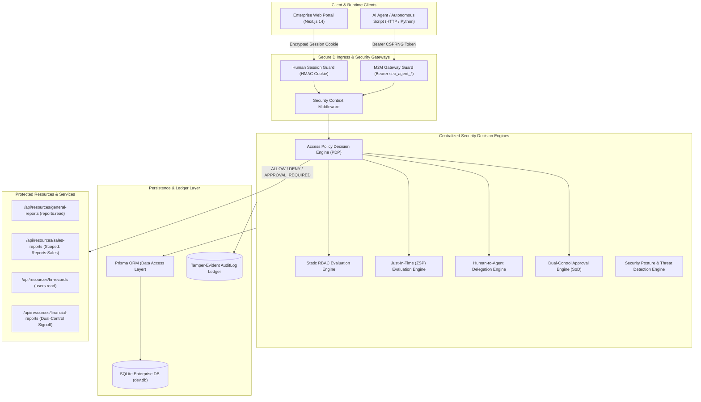
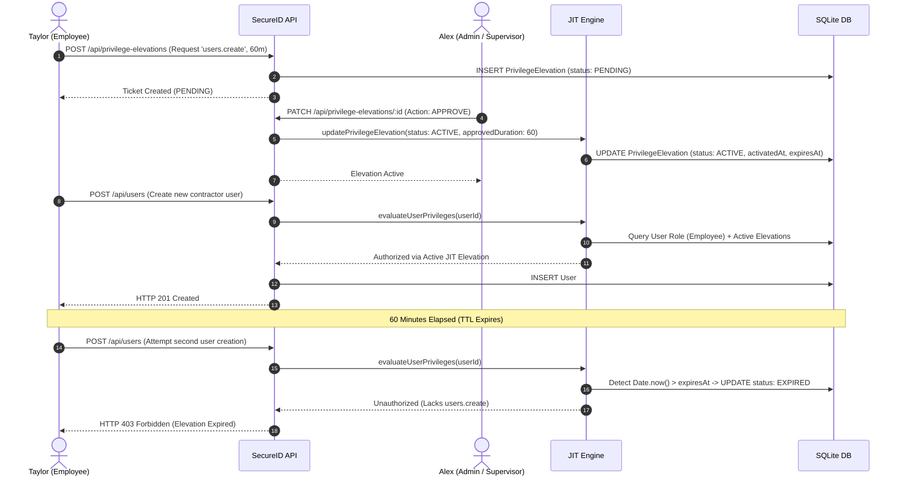
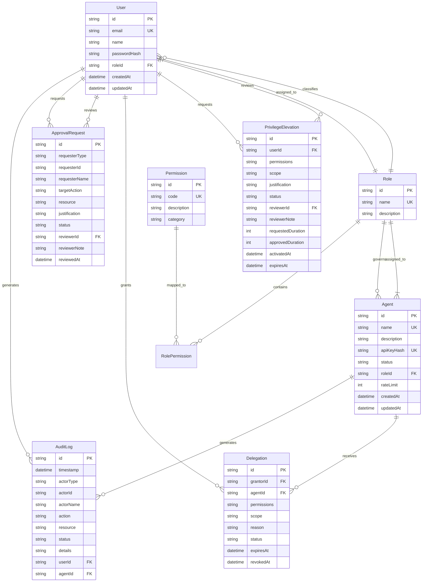

# SECUREID ARCHITECTURE & TECHNICAL SPECIFICATION
## Enterprise Role-Based Access Control (RBAC) & Autonomous AI Agent Identity Management System

```
  ███████╗███████╗ ██████╗██╗   ██╗██████╗ ███████╗██╗██████╗ 
  ██╔════╝██╔════╝██╔════╝██║   ██║██╔══██╗██╔════╝██║██╔══██╗
  ███████╗█████╗  ██║     ██║   ██║██████╔╝█████╗  ██║██║  ██║
  ╚════██║██╔══╝  ██║     ██║   ██║██╔══██╗██╔══╝  ██║██║  ██║
  ███████║███████╗╚██████╗╚██████╔╝██║  ██║███████╗██║██████╔╝
  ╚══════╝╚══════╝ ╚═════╝ ╚═════╝ ╚═╝  ╚═╝╚══════╝╚═╝╚═════╝ 
```

---

## 1. Executive Summary & Architecture Paradigm

**SecureID** is a Next-Generation Identity & Access Management (IAM) platform built specifically to govern both **human enterprise operators** and **autonomous AI agents** under unified Zero-Trust and Zero Standing Privilege (ZSP) principles.

In traditional enterprise infrastructure, human access and AI agent automation exist in fragmented silos. Autonomous agents frequently operate with static, over-privileged API keys with infinite time-to-live (TTL), while human operators retain broad standing privileges. SecureID bridges this governance gap by establishing:

1. **Dual Identity Lifecycle**: Equal-status governance for human actors (User) and machine actors (Agent).
2. **Zero Standing Privilege (ZSP)**: Defaulting all human operators to baseline low-privilege roles, dynamically augmenting privileges via time-bounded, peer-reviewed Just-In-Time (JIT) tickets without mutating permanent database role definitions.
3. **Human-to-Agent Delegated Authorization**: Allowing authorized human principals to temporarily delegate specific, scoped capabilities to AI agents without granting full human identity transfer or persistent privilege escalation.
4. **Centralized Policy Decision Point (PDP)**: Decoupled, centralized policy evaluation inspecting identity status, standing RBAC, active JIT elevations, human-to-agent delegations, and dual-control approval tickets.
5. **Separation of Duties (SoD)**: Multi-person approval controls preventing self-authorization of high-risk actions.
6. **Immutable Forensic Auditing**: Real-time tamper-evident recording of every human login, agent M2M execution, elevation grant, policy evaluation, and administrative decision.

---

## 2. High-Level System Architecture Diagram



---

## 3. Human Authentication vs Machine-to-Machine (M2M) Protocol

### 3.1 Human Authentication Model
- **Credential Storage**: Cryptographically hashed using `bcrypt` (10 salt rounds).
- **Session Delivery**: Stateless, tamper-resistant HTTP-only signed session cookie (`secureid_session`).
- **Authorization Context**: Server-side resolved from SQLite session records; client-supplied identity fields in request bodies or query params are strictly ignored.
- **Role Hierarchy**:
  - `Admin`: Full governance across users, roles, agents, delegations, policies, and audit ledgers.
  - `Manager`: Supervisory oversight, approval reviews, telemetry monitoring, and report auditing.
  - `Employee`: Least-privilege operational baseline; access limited to standard reporting and requesting JIT elevations.

### 3.2 Machine-to-Machine (M2M) Protocol
- **Machine Token Format**: High-entropy 256-bit cryptographically secure pseudorandom token with prefix `sec_agent_<32_hex_bytes>`.
- **Credential Storage**: The plaintext token is shown **strictly once** upon registration or rotation. SQLite stores only the salted `bcrypt` hash (`apiKeyHash`).
- **Verification Pipeline**:
  1. Prefix check: Token must begin with `sec_agent_`.
  2. Candidate agent resolution: In-memory SHA-256 digest lookup or database candidate evaluation.
  3. Constant-time Bcrypt verification against candidate agent's stored hash.
  4. Operational lifecycle check: Agent must be in `ACTIVE` state (blocked if `SUSPENDED` or `REVOKED`).
  5. Sliding-window rate limiter check (default 100-150 req/min per agent).
  6. Granular capability matching: Checks standing role permissions, followed by active Human-to-Agent Delegations within scope.

---

## 4. Zero Standing Privilege (ZSP) & Human JIT Elevation

### The Architectural Problem
Granting human employees standing administrative privileges creates persistent security liabilities (lateral movement, compromised credentials, privilege creep).

### The SecureID Zero Standing Privilege Solution
1. **Permanent Invariance**: An employee's permanent role in the database (`User.roleId`) is **never modified** when elevated privileges are granted.
2. **Time-Bounded Tickets**: Elevations exist solely as transient `PrivilegeElevation` records with explicit `activatedAt` and `expiresAt` timestamps.
3. **Supervisor Dual-Control**: Privilege elevation tickets require peer review or supervisor approval. Requesters cannot approve their own elevation requests (Separation of Duties).
4. **Lazy Expiration on Evaluation**: The RBAC guard (`src/lib/rbac.ts`) actively evaluates elevations at runtime. The instant `Date.now() > expiresAt`, the ticket is transitioned to `EXPIRED` status and elevation capabilities vanish immediately.



---

## 5. Human-to-Agent Delegated Authorization

SecureID introduces **first-class Human-to-Agent Delegation**. Rather than sharing human credentials or giving an AI agent broad administrative roles, an authorized human principal can delegate a subset of their own permissions to an AI agent under strict constraints:

- **Grantor Bound**: An administrator or manager can **only delegate permissions that they themselves actively possess**.
- **Agent Lifecycle Bound**: Inactive, suspended, or revoked agents cannot execute delegated authority.
- **Resource Scoping**: Delegations are bounded by resource scopes (e.g., `Reports:Sales` vs `Reports:General`). Access to an out-of-scope resource is immediately blocked with HTTP 403.
- **Immediate Revocation**: An administrator can revoke a delegation at any second. Revocation immediately purges machine authorization without needing key rotation.
- **Temporal TTL**: Delegations have fixed maximum lifetimes (enforced up to 24 hours).

---

## 6. Centralized Policy Decision Point (PDP)

The SecureID Centralized Policy Engine (`src/lib/policy-engine.ts`) consolidates access decision logic into an enterprise Policy Decision Point (PDP):

```
Decision = PDP(Subject, Action, Resource, Context)
Output ∈ { ALLOW, DENY, APPROVAL_REQUIRED }
```

### Evaluation Hierarchy:
1. **Subject Status Verification**: Is the User or Agent `ACTIVE`? If `SUSPENDED` or `REVOKED`, return `DENY`.
2. **Standing Role Permissions**: Does the assigned Role have the requested permission code?
   - If User has standing role -> return `ALLOW` (Grant: `PERMANENT_ROLE`).
   - If Agent has standing role AND resource requires dual-control signoff -> evaluate approval ticket.
3. **Just-In-Time Elevation Verification (Humans)**: Does the User have an unexpired `ACTIVE` `PrivilegeElevation` ticket with matching permission and scope?
   - If Yes -> return `ALLOW` (Grant: `JIT_ELEVATION`).
4. **Delegated Authority Verification (Agents)**: Does the Agent have an unexpired `ACTIVE` `Delegation` from a valid grantor holding the permission, with matching resource scope?
   - If Yes -> return `ALLOW` (Grant: `DELEGATION`).
5. **Dual-Control Human Signoff Policy**: Does the resource represent high-risk operations (e.g. `Reports:SensitiveFinancial`)?
   - If calling agent lacks approved supervisor signoff ticket -> return `APPROVAL_REQUIRED`.
6. **Default Fallback**: Return `DENY` with comprehensive evaluation trace and security audit recording.

---

## 7. Entity Relationship & Data Model



